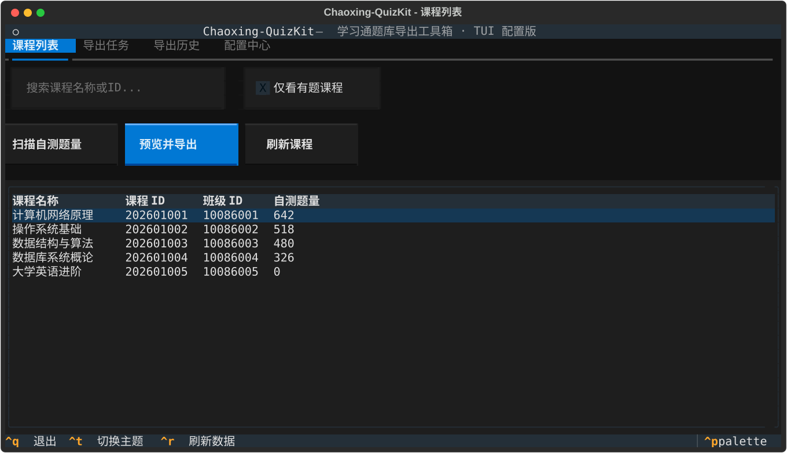
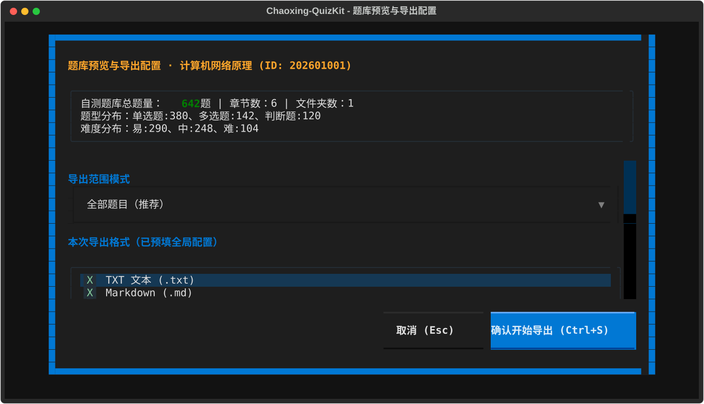

# Chaoxing-QuizKit

[](https://github.com/musan87/Chaoxing-QuizKit/releases/latest)
[](LICENSE)
[](https://www.python.org/)
[](#运行方式)

超星学习通个人课程自测题库导出工具箱，提供终端可视化交互界面（TUI）、中文注释外部配置与图文多格式导出。

## 核心特性

- **个人课表精准识别**：仅加载当前账号真实加入的学习通课程，精准扫描每门课程是否由任课老师开通自测题库及具体题量。
- **突破单卷 500 题限制**：按章节目录自动分批组卷、直接读取答案解析页并自动清理临时自测卷（不留残留记录），支持补充抓取未归类散题。
- **导出前概览与范围勾选**：导出前预览总题数、章节、题型与难度分布，支持按全部 / 章节 / 题型 / 难度灵活筛选导出。
- **多格式导出与目录整理**：支持 `TXT`、`Markdown (.md)`、`Word (.docx)`、`PDF (.pdf)`、`JSON (.json)`，默认按纯课程名归档到 `out/<课程名>/`，每种格式默认输出 1 份文件，可选同时生成**无答案刷题版**及按章节/题型拆分文件。
- **图片本地化与内嵌**：默认下载题目/答案中的图片到 `out/<课程名>/images/` 并直接内嵌到 Markdown / Word / PDF 文档，也可在导出前或配置中心按需开关。
- **可视化配置中心**：支持在 TUI 中通过「快捷配置 / 完整配置 / YAML 编辑」实时修改并保存 [config.yml](config.yml)，支持亮/暗主题切换（`Ctrl+T`）。
- **账号安全**：不保存手机号、密码或 Cookie，每次启动均需手动登录，登录请求全程采用 HTTPS 加密传输。

---

## 界面预览

| 课程列表与题量扫描 | 导出前预览与范围配置 |
| :---: | :---: |
|  |  |

---

## 运行方式

### 方式 1：通过单文件 EXE 运行（推荐，Windows 无需 Python 环境）

1. 前往 [Releases 最新版本页面](https://github.com/musan87/Chaoxing-QuizKit/releases/latest) 下载 `Chaoxing-QuizKit.exe`。
2. 放到任意目录后双击运行即可：
   - 首次启动会自动在 `.exe` 同级目录生成带中文注释的 `config.yml`。
   - 导出结果默认保存在同级 `out/<课程名>/` 目录中。

### 方式 2：通过源码运行（支持 Windows / macOS / Linux）

1. 安装依赖（推荐 Python 3.10+）：

```shell
pip install -r requirements.txt
```

2. 启动程序（进入 TUI 终端交互界面）：

```shell
python main.py
```

---

## 配置文件说明

首次运行后会在程序同级目录自动生成 `config.yml`（内含完整中文注释），也可以在程序内的 **「配置中心」** 直接修改并热生效：
- `export_formats`: 导出格式列表，可选 `[txt, md, docx, pdf, json]`
- `export_no_answer_edition`: 是否同时生成无答案刷题版
- `bulk_files` / `bulk_split_by`: 是否按章节或题型拆分为多个文件保存
- `allow_overwrite_files` / `save_timestamp_backup`: 控制是否覆盖同名文件或额外保留时间戳备份
- `download_images`: 默认 `true`，下载题目/答案图片到本地并内嵌到 Word/PDF/Markdown

---

## 本地打包 EXE（Windows）

在安装了项目依赖与 `PyInstaller`（`pip install pyinstaller`）后，运行打包脚本即可生成单文件 `dist/Chaoxing-QuizKit.exe`：

```powershell
powershell -ExecutionPolicy Bypass -File build_exe.ps1
```

---

## 常见问题（FAQ）

1. **Windows 提示「Windows 已保护你的电脑」或杀毒软件误报**
   - 由于独立打包的 `PyInstaller` 单文件 EXE 未购买商业代码签名证书，Windows SmartScreen 或部分杀软可能出现拦截提示，属常见误报。
   - 请仅从本仓库 [Releases 页面](https://github.com/musan87/Chaoxing-QuizKit/releases/latest) 下载并核对页面展示的 `SHA256` 校验值；若仍不放心，可直接采用「源码运行」或本地执行 `build_exe.ps1` 自行编译。
2. **部分课程的自测题量显示为 0**
   - 本工具仅导出课程内由任课教师开通的「自测」题库；未开通自测功能或题库为空的课程会显示 `0`。
3. **登录信息与账号是否安全？**
   - 本程序不会将手机号、密码或 Cookie 写入磁盘，登录与数据请求全程采用 HTTPS 加密传输（不经过任何第三方中转服务器），退出程序即销毁内存中的会话状态。

---

## 开源协议与免责声明

- 本项目基于 [GNU General Public License v3.0](LICENSE) 开源。
- **免责声明**：本项目仅供个人对本人合法选修课程进行学习、复习与资料整理使用，严禁用于考试作弊、未经授权传播题库或任何商业用途；因违反平台规则或不当使用所产生的一切后果由使用者自行承担。
